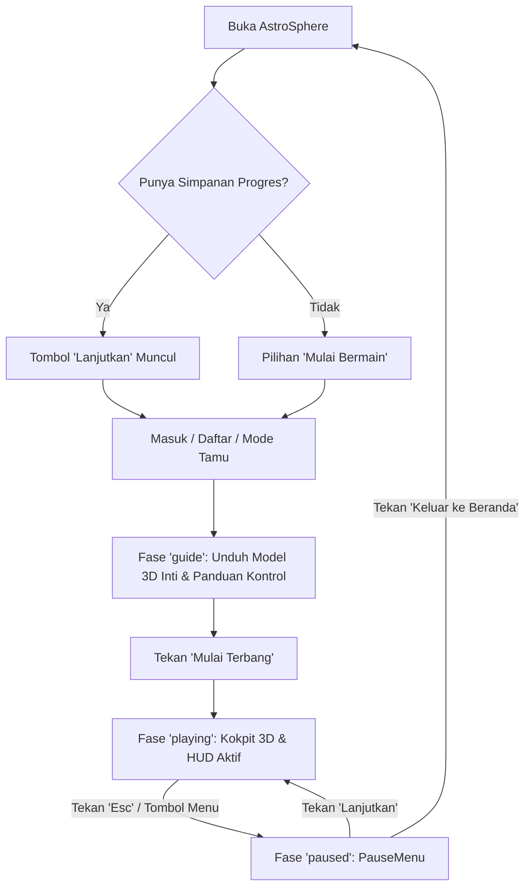

# Product Requirement Document (PRD) Aktual: Sisi Publik & Permainan AstroSphere

> **Dokumen Status Aktual Kode (Living Document)**  
> **Versi Proyek:** Nuxt 4 + Three.js + Supabase Auth & Cloud Sync  
> **Cabang Git:** `integrasi-nuxt`  
> **Tanggal Audit & Penyusunan:** November 2026  
> **Sifat Dokumen:** Dokumentasi faktual & objektif mengenai arsitektur, antarmuka, kontrol, fitur edukasi, mekanika permainan, dan ekonomi poin yang benar-benar berjalan di kode sumber saat ini tanpa asumsi fiktif.

---

## 1. Ikhtisar Produk (Product Overview)

**AstroSphere** adalah platform web interaktif 3D bertema eksplorasi antariksa edukatif yang dibangun menggunakan **Nuxt 4**, **Vue 3 (Composition API)**, dan **Three.js**. AstroSphere memadukan simulasi ruang angkasa realistis, navigasi pesawat antariksa (*space flight simulator*), ensiklopedia astronomi terverifikasi (terintegrasi dengan basis data Supabase & katalog lokal), mini-game berbasis inkuiri sains (*Predict-Observe-Explain*), laboratorium gerhana, kuis formatif, dan reka ulang misi sejarah antariksa nyata.

Aplikasi dirancang responsif dan mulus untuk perangkat desktop (kontrol keyboard, tetikus) maupun perangkat layar sentuh/ponsel pintar (kontrol kokpit terpadu dengan stik kemudi analog dan tuas dorong vertikal).

---

## 2. Alur Pengguna dari Awal hingga Bermain (User Journey)

### 2.1. Arsitektur Fase Permainan (`store.phase`)
Cangkang aplikasi (`app/pages/index.vue`) mengatur siklus hidup tampilan melalui mesin status reaktif `store.phase`:
1. `splash`: Layar pembuka berbasis HTML/CSS murni dan visual live Three.js ringan (`liveBackdrop.js`). Tidak mengunduh model GLB berat pada tahap ini agar *First Contentful Paint* (FCP) sangat cepat.
2. `guide`: Layar pengenalan kontrol & status pemuatan (*loading screen*). Pada tahap ini, mesin Three.js penuh (`engine.js`) diinisialisasi dan model aset inti diunduh bertahap (~2,5 MB).
3. `playing`: Layar simulasi ruang angkasa 3D aktif dengan kokpit HUD, pergerakan pesawat, dan transisi kamera.
4. `paused`: Menu jeda modal yang membekukan simulasi sementara dan menyediakan navigasi ke seluruh fitur penjelajah.

### 2.2. Varian Alur Masuk Pengguna (`Splash.vue`)
Komponen `Splash.vue` mendukung 4 alur masuk penjelajah:
1. **Pengguna Baru (Mode Tamu / *Guest*):**
   - Menekan tombol **"Mulai bermain"** pada layar selamat datang (`store.screen = 'welcome'`).
   - Sistem memanggil `play(false)`: progres baru diinisialisasi secara lokal di `localStorage`, bendera `store.startFromSave = false`, dan transisi ke `store.phase = 'guide'`.
2. **Pengguna Memiliki Simpanan Progres (*Continue Game*):**
   - Jika `store.hasSave === true` (terdeteksi koordinat posisi kapal dan rotasi valid di `astrosphere.gameState`), tombol **"Lanjutkan (Dekat [Planet] · X penemuan)"** akan muncul sebagai aksi utama.
   - Menekan tombol ini memanggil `play(true)`: kapal akan dimuat tepat di titik koordinat terakhir tersimpan.
3. **Pengguna Masuk Akun (*Sign In*):**
   - Memilih menu **"Masuk"** (`store.screen = 'login'`).
   - Memasukkan nama penjelajah (3–20 karakter alfanumerik) dan kata sandi ($\ge 6$ karakter).
   - Menghubungkan ke **Supabase Auth** (`loginUser`). Jika terhubung, data progres awan di tabel `player_progress` otomatis diselaraskan (*merged*) dengan data lokal.
4. **Pengguna Mendaftar Akun Baru (*Sign Up*):**
   - Memilih menu **"Daftar"** (`store.screen = 'register'`).
   - Mendaftarkan akun ke Supabase Auth (`registerUser`). Akun baru dibuat dengan email sintetis aman (`<username>@player.astrosphere.app`) dan progres lokal langsung diunggah ke awan.
5. **Cadangan Luar Jaringan (*Offline Fallback*):**
   - Jika koneksi Supabase terputus atau variabel lingkungan belum diisi, sistem otomatis mengalihkan autentikasi ke basis data lokal yang diamankan dengan enkripsi *salted hash* SHA-256 / FNV-1a di `localStorage`.

### 2.3. Elemen Tampilan Layar Utama Saat Terbang (`playing` & `jelajah`)
Saat berada di dalam kokpit terbang bebas (`store.mode === 'jelajah'`), antarmuka terdiri atas:
- **Bilah Atas (`TopBar.vue`):**
  - Kiri: Logo brand & teks `AstroSphere` (disembunyikan di layar HP kecil demi ruang pandang).
  - Kanan:
    * Tombol cepat **Misi** (ikon roket) dengan popover menu untuk langsung meluncurkan Misi Apollo 13 atau MCO dalam 1-klik, lengkap dengan lencana status misi selesai (`missionsCompleted / 2`).
    * Tombol cepat **Profil Pemain** (ikon pengguna).
    * Tombol **Menu Jeda** (ikon burger) dengan lencana notifikasi (*badge*) kartu jurnal baru yang belum dibaca.
- **HUD Kompas & Penanda Target (`engine.js` & `GameHud.vue`):**
  - Kompas derajat navigasi di bagian atas tengah (`000°`–`359°`).
  - Penanda bidik silang (*crosshair*) di tengah layar.
  - Panah penunjuk arah target berwarna kuning (*off-screen indicator*) jika target berada di luar bidang pandang kamera.
  - Penanda chip tujuan di bawah kompas: Menampilkan nama tujuan terpilih, titik warna spektrum, jarak saat ini, serta tombol pintas **Terbang otomatis**. Mengklik chip membuka daftar pemilihan tujuan (Matahari, 8 planet, dan Bulan).
- **Pesan Kedekatan Planet / Zona Hijau (`approach-green-card` di `GameHud.vue`):**
  - Muncul di **tengah atas, tepat di bawah kompas arah dan chip target** (`left: 50%; transform: translateX(-50%)`) tepat saat kapal berada pada radius ambang $\le 4\times$ jarak pendekatan planet. Menampilkan radar pulsar hijau, nama planet, dan jarak mendekat secara *real-time*. Posisi di tengah atas ini menjamin indikator tidak pernah berdesakan atau menimpa tuas dorong kokpit di kanan bawah.
- **Kokpit Bawah Terpadu (`GameHud.vue`):**
  - **Kiri Bawah:** Stik kemudi analog (*Cockpit Stick*) untuk mengendalikan arah moncong kapal (*yaw* dan *pitch*).
  - **Kanan Bawah:** Tuas dorong kapal antariksa (*Cockpit Throttle Lever*) vertikal (slot: TURBO, MAJU, NETRAL, REM), angka telemetri kecepatan digital (km/s), lencana status, dan tombol **Berhenti** cepat (Spasi).
- **Banner Peristiwa Bahaya Antariksa (`EventHud.vue`):**
  - Muncul saat terjadi Badai Matahari atau Sampah Antariksa, dilengkapi pengukur daya tahan perisai (*shield meter*).
  - Dilengkapi banner peringatan bahaya berdenyut saat perisai rusak ($0\%$) dengan petunjuk terbang ke planet terdekat untuk pemulihan otomatis.

---

## 3. Mekanika Terbang, Fisika, Kontrol & Navigasi Antariksa

### 3.1. Model Fisika & Dinamika Gerak (`engine.js`)
Fisika penerbangan AstroSphere dirancang khusus untuk kenyamanan penjelajahan antariksa edukatif (tidak membingungkan pemain dengan pergeseran menyamping yang tidak realistis):
1. **Vektor Dorongan Belakang Tunggal (*Rear Propulsion Physics*):**
   - Gaya dorong hanya berasal dari mesin pendorong buritan (*stern thruster*). Pesawat bergerak maju searah moncong kapal.
   - Pendorong mundur hanya berfungsi sebagai pengereman aktif (*reverse thrusters* / deselerasi), bukan untuk bermanuver lateral.
2. **Penghapusan Geser Samping (*Zero Strafe*):**
   - Kode sengaja mengunci `input.strafe = 0`. Kapal tidak bisa bergeser ke samping secara aneh saat diam maupun melaju.
3. **Kemudi Moncong Realistis (*Yaw & Banking Roll*):**
   - Input kemudi horizontal (tombol `A`/`D`, panah kiri/kanan, atau sumbu X analog) memutar sudut geleng moncong (*yaw*).
   - Saat berbelok, kapal secara otomatis menerapkan kemiringan sayap aerodinamis halus (*banking roll*) hingga $\pm 0.45\text{ rad}$ ($\pm 25^\circ$), dan secara otomatis kembali tegak (*auto-leveling*) saat input dilepas.
4. **Tingkat Kecepatan Kapal:**
   - **Maju Biasa:** Diatur proporsional oleh tuas gas ($0$ hingga kecepatan jelajah dasar kapal, misalnya $70\text{ km/s}$ pada Astra Scout).
   - **Turbo (Pendorong Penuh):** Dipicu oleh tombol `Shift` atau tuas paling atas; melipatgandakan kecepatan hingga $4.5\times - 5.6\times$ disertai efek partikel distorsi terowongan kecepatan (*boost warp lines*).
   - **Rem / Mundur:** Menekan `Ctrl`, `S`, atau tuas bawah mengurangi kecepatan secara progresif.
   - **Berhenti Seketika (*Quick Stop*):** Menekan tombol `Spasi` atau tombol visual "Berhenti" memotong kecepatan seketika ke 0 km/s.

### 3.2. Skema Kontrol: Desktop vs Layar Sentuh

| Aksi Navigasi | Kontrol Desktop (Keyboard & Tetikus) | Kontrol Ponsel (Layar Sentuh Terpadu) |
| :--- | :--- | :--- |
| **Kemudi Moncong (Kiri/Kanan)** | Tombol `A` / `D` atau Panah Kiri / Kanan | Geser knop stik analog kiri-bawah secara horizontal |
| **Elevasi Moncong (Naik/Turun)** | Tombol `E` (Naik) / `Q` (Turun) atau Panah Atas / Bawah | Geser knop stik analog kiri-bawah secara vertikal |
| **Maju / Tambah Dorongan** | Tombol `W` | Tarik tuas dorong kanan-bawah ke atas (slot MAJU) |
| **Pendorong Turbo** | Tombol `Shift` (tahan) | Tarik tuas dorong kanan-bawah ke puncak (slot TURBO) |
| **Rem / Perlambat** | Tombol `S` atau `Ctrl` | Tarik tuas dorong kanan-bawah ke bawah (slot REM) |
| **Berhenti Seketika** | Tombol `Spasi` | Ketuk tombol "Berhenti" di atas rel tuas dorong |
| **Bebas Lihat Sekeliling** | Seret Tetikus (*drag cursor*) di area angkasa | Seret jari di area tengah/atas layar |
| **Buka Peta Tata Surya** | Tombol `M` | Buka dari Menu Jeda (`Esc`) |
| **Ganti Target Cepat** | Tombol `T` | Ketuk chip Tujuan di bawah kompas |

### 3.3. Pemicu Jarak Planet: Zona Hijau vs Kartu Pendekatan (`ApproachCard.vue`)
Sistem navigasi membagi kedekatan planet menjadi dua lapisan ambang matematis:
1. **Zona Hijau Peringatan Kedekatan ($\text{dist} \le 4\times \text{approachRadius}$):**
   - Muncul sebagai kartu mengambang futuristik di **tengah atas layar (tepat di bawah kompas navigasi dan chip target)**.
   - Memberikan sinyal visual bahwa pemain sudah memasuki orbit luar planet tanpa menghentikan kontrol pesawat pemain, serta bebas dari konflik tata letak dengan tuas dorong kokpit di kanan bawah.
   - Di luar radius $4\times$, elemen ini 100% tersembunyi demi kebersihan layar (*clean cockpit view*).
2. **Kartu Berhenti Otomatis (`ApproachCard`, $\text{dist} < \text{approachRadius}$):**
   - Saat kapal melintasi radius pendekatan aman ($r \approx 14 - 36$ unit dunia tergantung ukuran planet), kapal **berhenti otomatis** ke kecepatan 0 km/s.
   - Kotak dialog interaktif muncul di tengah layar: menampilkan nama planet, kategori benda, deskripsi ringkas, bocoran tebakan fenomena (*teaser*), serta dua tombol aksi:
     - **"Ya, lihat" (`Enter`):** Mengalihkan mode kamera ke orbit dekat (`store.mode = 'planet'`).
     - **"Tidak, lanjut terbang" (`Esc`):** Menolak kunjungan.
   - **Mekanisme Anti-Spam (*Debounce*):** Jika pemain memilih "Tidak, lanjut terbang", status `b.inRange` dikunci pada nilai `true`. Popup kartu pendekatan TIDAK AKAN MUNCUL LAGI sampai kapal menjauh melebihi $1.35\times \text{approachRadius}$. Hal ini menjamin pemain bebas terbang melintasi planet tanpa diganggu popup berulang.

### 3.4. Peta Tata Surya 2D Top-Down (`MapPanel.vue`) & Terbang Otomatis
- **Skala Visual Akar Kuadrat:** Jarak orbit pada canvas 2D dipetakan dengan transformasi matematika non-linear $f(r) = \sqrt{r / R_{\text{MAX}}} \cdot R_{\text{px}}$ agar planet-planet bagian dalam (Merkurius hingga Mars) tidak menumpuk saling tindih dengan planet raksasa gas luar.
- **Terbang Otomatis (*Autopilot*):**
  - Pemain dapat memilih planet mana pun di Peta atau HUD lalu menekan tombol **"Terbang otomatis"**.
  - Mesin navigasi (`engine.js`) menghitung vektor arah ke target, memutar hidung kapal secara otomatis (*auto-yaw alignment*), memacu dorongan turbo, dan mengerem secara sempurna saat tiba di ambang orbit aman planet tujuan.
  - Autopilot dapat dibatalkan seketika kapan saja jika pemain menekan kontrol manual atau tombol batalkan.

### 3.5. Batas Tata Surya & Fisika Tabrakan Permukaan
- **Batas Terluar Tata Surya ($R_{\text{MAX}} = 14.000\text{ unit}$):**
  - Radius jelajah aman tata surya dibatasi hingga $R = 11.200$ ($0.8\times R_{\text{MAX}}$).
  - Jika pemain melampaui $11.200$, banner peringatan merah `"Batas tata surya — putar balik"` muncul dan sistem rem otomatis aktif perlahan.
  - Jika pemain menembus $R_{\text{MAX}}$ ($14.000$), kapal secara tegas ditarik kembali ke radius aman $0.98\times R_{\text{MAX}}$ dengan vektor pantulan.
- **Tabrakan Fisik Permukaan Planet & Matahari:**
  - Jarak minimal kapal terhadap permukaan planet dikunci pada $R_{\text{planet}} + 1.6\text{ unit}$, sedangkan untuk Matahari adalah $R_{\text{matahari}} + 25\text{ unit}$.
  - Jika pemain memaksa menabrakkan kapal, kecepatan kapal dibatalkan menjadi nol, kapal dipantulkan mundur, dan goncangan kamera (*camera shake*) dipicu untuk memberikan umpan balik tabrakan realistis tanpa menghancurkan kapal secara permanen.

---

## 4. Rincian Lengkap Seluruh Fitur & Panel Edukasi

### 4.1. Panel Observasi Planet & Matahari (`PlanetPanel.vue`, `SunPanel.vue`, `TimeBar.vue`)
Saat pemain mengamati planet dari dekat:
- **Katalog Observasi Ilmiah 6 Kotak (Sesuai Standar PLY-02):**
  1. *Diameter Ekuator:* Ukuran dalam kilometer dan perbandingan proporsional terhadap ukuran Bumi (contoh: Jupiter $11.20\times$ ukuran Bumi).
  2. *Periode Rotasi:* Lama rotasi dalam jam/hari Bumi serta keterangan putaran normal atau retrograd (contoh: Venus berotasi terbalik).
  3. *Periode Orbit:* Waktu revolusi mengitari Matahari dalam hari atau tahun Bumi.
  4. *Kemiringan Sumbu:* Sudut kemiringan sumbu rotasi terhadap bidang orbit dalam derajat (contoh: Uranus $97.77^\circ$).
  5. *Suhu Rata-Rata:* Suhu permukaan dalam derajat Celsius beserta rentang minimum/maksimumnya.
  6. *Usia Planet:* Usia estimasi geologis sejak pembentukan tata surya ($\pm 4.5\text{ miliar tahun}$).
- **Kontrol Simulasi Waktu Observasi (`TimeBar.vue`):**
  - Terletak di kiri bawah layar observasi planet.
  - Memungkinkan pemain memutar, menjeda (*pause*), atau mempercepat jalannya waktu orbit ($1\times, 10\times, 100\times$).
  - Opsi *toggle* garis orbit elips dan sumbu rotasi aksial planet secara 3D.
- **Fitur Khusus Matahari (`SunPanel.vue`):**
  - Menampilkan fakta unik bintang induk tata surya.
  - Akordeon topik mendalam yang jarang diketahui: *Cincin Matahari (Halo $22^\circ$)*, *Gerhana Cincin*, *Anomali Suhu Korona*, *Bintik Matahari*, *Badai Geomagnetik*, dan *Diferensiasi Rotasi Gas*. Dilengkapi tombol pintas langsung menuju laboratorium gerhana.

### 4.2. Panel Sejarah Eksplorasi Antariksa (`HistoryPanel.vue`)
Fitur lini masa sejarah interaktif per benda langit yang terhubung ke Supabase (`history_events`) dengan fallback lokal:
1. **Sistem Filter Dua Tingkat:**
   - **Khusus Planet Bumi:**
     - *Filter Tingkat 1 (6 Zaman Utama):* `Semua Zaman`, `Awal Bumi & Purba (≤ 250 Jt SM)`, `Dinosaurus & Kapur (250–66 Jt SM)`, `Manusia Purba & Batu (66 Jt–3000 SM)`, `Peradaban Kuno & Kenabian (3000 SM–500 M)`, `Pertengahan & Nusantara (500–1499 M)`, dan `Zaman Modern (1500–Kini)`.
     - *Filter Tingkat 2 (Rentang Abad Modern):* Jika memilih Zaman Modern, muncul sub-filter rentang 1 abad: `1500–1599 (Abad 16)`, `1600–1699 (Abad 17)`, `1700–1799 (Abad 18)`, `1800–1899 (Abad 19)`, `1900–1999 (Abad 20)`, dan `2000–Sekarang (Abad 21)`.
   - **Planet Lain:** Filter berdasarkan era astronomi (`Semua`, `Kuno`, `Teleskopik`, `Era Antariksa`).
2. **Alur Navigasi Daftar (*List*) $\leftrightarrow$ Detail Terstruktur:**
   - *Tampilan Daftar:* Kartu lini masa vertikal dengan penanda tahun kejadian, label kategori POI, thumbnail foto, nama wahana/tokoh, dan ringkasan singkat.
   - *Tampilan Detail:* Banner foto beresolusi penuh (dengan pengamanan `isSafeMediaUrl`), 4 baris metadata terstruktur (Kategori POI, Status/Era, Wahana/Tokoh, Karakteristik Fisik/Koordinat), Kartu Memorial Pahlawan Gugur Tugas (Apollo 1, Challenger STS-51-L, Columbia STS-107), uraian sejarah komprehensif, dan sumber referensi institusi resmi (NASA/ESA).
3. **Kamera Interaktif 3D ke Titik POI (Dukungan 100% Data Supabase):**
   - Tombol **"Lihat di 3D"** memutar kamera mengitari bola planet dan menyorot titik lokasi peristiwa.
   - Untuk data Supabase (`history_events`) yang tidak memiliki kolom koordinat `lat`/`lng`, sistem menggunakan **Algoritma Fibonacci Sphere Deterministik** (`getEventCoords` di `system.js` dan `engine.js`) berbasis hash ID/indeks peristiwa. Titik-titik POI terdistribusi merata dan konsisten di permukaan bola ($y \in [-0.82, 0.82]$), bebas dari penumpukan kutub.
   - Kamera 3D secara presisi mengunci sudut rotasi planet dan mengarahkan pandangan tepat ke pin POI yang dipilih.

### 4.3. Panel Fenomena Sains & Laboratorium Gerhana (`PhenomenonPanel.vue` & `lab.js`)
Menerapkan paradigma inkuiri ilmiah **POE (*Predict - Observe - Explain*)**:
- **Fitur "Tebak Dulu" (*Predict Phase*):**
  - Sebelum simulasi fenomena dijalankan, pemain disajikan pertanyaan pemantik tebakan (contoh: *"Bulan jauh lebih kecil dari Matahari, bisakah menutupi Matahari sepenuhnya?"*).
  - Jawaban benar pertama kali diganjar hadiah **+10 Bintang**.
- **Laboratorium Gerhana Bumi (`store.lab`):**
  - Pemain dapat mengganti jenis gerhana (*Gerhana Matahari* vs *Gerhana Bulan*).
  - Dilengkapi *timeline scrubber* interaktif untuk memajukan/memundurkan posisi Bulan melintasi kerucut umbra dan penumbra Bumi secara visual.
  - Tersedia 6 sudut pandang kamera (*POV*): Samping, Depan, Atas, Jauh, Pengamat dari Permukaan Bumi, dan Bebas.
- **Simulasi Fenomena Planet Lain:**
  - Tiap planet memiliki fenomena unik: Rotasi Ekstrem & Suhu Merkurius, Efek Rumah Kaca & Rotasi Mundur Venus, Badai Debu Global Mars, Bintik Merah Jupiter, Cincin Tipis Saturnus, Kemiringan Rebah Uranus, dan Angin Supersonik Neptunus. Waktu dipercepat ribuan kali agar dinamika terlihat jelas.

### 4.4. Panel Kuis Formatif (`QuizPanel.vue` & `quiz.js`)
- Kuis formatif tersedia untuk seluruh 8 planet utama.
- **Syarat Terbuka:** Kuis sebuah planet baru terbuka setelah pemain pernah terbang menjelajah mendekati planet tersebut (`isFound(planetId)`). Hal ini mendorong pemain untuk berpetualang terlebih dahulu.
- **Struktur Kuis Dinamis:** Jumlah butir soal per planet diselaraskan secara dinamis mengikuti bank soal Supabase (`set.questions.length`, umumnya 3 hingga 5+ soal) dan tidak lagi kaku pada angka 3.
- **Pengacakan Pilihan:** Urutan opsi jawaban diacak setiap kali percobaan kuis dimulai (`shuffle`).
- **Umpan Balik Seketika:** Memilih jawaban langsung memberikan status Benar/Salah disertai kotak penjelasan ilmiah mendalam.
- **Aturan Penilaian Non-Punitive:** Jawaban salah **tidak mengurangi bintang**. Poin kuis adalah 50 poin per butir benar, dengan skor maksimal dihitung dinamis ($N_{\text{soal}} \times 50$ poin).

### 4.5. Panel Misi Kisah Nyata (`MissionPanel.vue`, `McoPanel.vue`, `mission.js`, `missionMco.js`)
AstroSphere memiliki dua adegan simulasi 3D dan skenario misi sejarah berdikari yang dapat diakses melalui **PauseMenu**, tombol cepat **"Misi"** di Bilah Atas (`TopBar.vue`), maupun secara **kontekstual di Observasi Planet (`PlanetPanel.vue`)**:
1. **Misi Apollo 13 (1970) — "Kegagalan yang Berhasil":**
   - Dapat diakses kontekstual saat mengamati **Bulan (`bulan`)** di `PlanetPanel.vue` melalui kartu ajakan *"Misi Bersejarah: Apollo 13 (1970)"* lengkap dengan indikator bintang performa.
   - Menyimulasikan ledakan tangki oksigen nomor 2 pada modul layanan di jarak $320.000\text{ km}$ dari Bumi.
   - Pemain memandu 3 astronaut (Lovell, Swigert, Haise) melalui 5 tahapan penyelamatan kritis:
     1. *Keputusan Darurat:* Memilih meluncur memutari Bulan (*free-return trajectory*) daripada memutar balik langsung.
     2. *Penghematan Daya:* Mematikan instrumen non-kritis (pemanas, lampu, komputer navigasi modul komando) agar baterai tersisa untuk pendaratan.
     3. *Koreksi Arah Mesin:* Mini-game menahan tombol bakar mesin modul pendarat (*lunar module burn*) tepat pada rentang target hijau.
     4. *Perakitan Kotak Surat CO₂:* Memilih barang di kabin (lakban, plastik, karton, selang baju antariksa) untuk merakit adaptor saringan udara darurat.
     5. *Masuk Atmosfer (*Re-entry*):* Mengendalikan sudut elevasi masuk kapsul ($5.5^\circ - 7.5^\circ$) di tengah guncangan atmosferik.
   - Hadiah: **+30 Bintang** saat tamat pertama kali, beserta penilaian bintang performa (1–3 bintang misi).
2. **Misi Mars Climate Orbiter (1999) — "Misteri Satuan":**
   - Dapat diakses kontekstual saat mengamati **Mars (`mars`)** di `PlanetPanel.vue` melalui kartu ajakan *"Misi Penyelamatan: Mars Climate Orbiter (1999)"* lengkap dengan status bintang performa.
   - Menyimulasikan peristiwa hilangnya wahana penjelajah cuaca Mars akibat salah komunikasi satuan antara tim pembuat wahana (Lockheed Martin, menggunakan satuan imperial *pound-force seconds*) dan tim navigasi (NASA JPL, menggunakan satuan metrik SI *newton seconds*).
   - Tahapan: Pengamatan hilangnya sinyal $\rightarrow$ Investigasi petunjuk arsip $\rightarrow$ Ulangi sejarah dengan mengonversi paket data ($1\text{ lbf}\cdot\text{s} = 4.45\text{ N}\cdot\text{s}$) $\rightarrow$ Memasukkan wahana secara sukses ke orbit Mars pada ketinggian aman $226\text{ km}$.
   - Hadiah: **+30 Bintang** saat tamat pertama kali.

### 4.6. Peristiwa Antariksa / Hazards (`hazards.js` & `EventHud.vue`)
Peristiwa dinamis acak yang muncul saat terbang di ruang jelajah untuk menantang kewaspadaan pemain:
1. **Badai Matahari (*Solar Storm*):**
   - Muncul peringatan dini 30 detik.
   - Partikel radiasi berenergi tinggi menyapu tata surya selama 22 detik.
   - **Solusi Edukatif:** Pemain harus mengarahkan kapal ke balik bayangan planet atau satelit terdekat (*shadow cone*). HUD menyediakan indikator pemandu arah bayangan malam.
2. **Sampah Antariksa (*Space Debris*):**
   - Terjadi di sekitar orbit rendah Bumi ($20 - 320\text{ unit}$ di atas permukaan Bumi).
   - Pecahan satelit mati dan panel surya melesat ke arah kapal selama 18 detik.
   - Pemain harus aktif bermanuver menghindar dengan membelokkan kapal atau naik-turun.
3. **Mekanika Perisai & Kerusakan Mesin:**
   - Tabrakan sampah atau paparan radiasi menguras perisai kapal (`ev.shield`).
   - Jika perisai habis ($0\%$), kapal mengalami status **Rusak** (*Damaged*): Pendorong Turbo mati total dan kecepatan maksimal dibatasi hingga $60\%$.
   - **Banner Peringatan Perisai Rusak:** `EventHud.vue` memunculkan banner bahaya berdenyut (*pulse danger*): *"Perisai rusak (Turbo nonaktif) — terbang mendekati planet terdekat untuk perbaikan otomatis."*
   - **Cara Perbaikan & Pemulihan:** Segera setelah kapal mendekati radius pendekatan planet atau satelit mana pun, perisai otomatis pulih $100\%$, status rusak dicabut, dan sistem memicu notifikasi toast ceria *"Perisai pesawat pulih 100%!"* beserta SFX pemulihan.
   - Hadiah: Berhasil selamat dari peristiwa menghadiahkan **+10 Bintang**.

### 4.7. Jurnal Penjelajah & Game "Mitos atau Fakta?" (`Journal.vue`, `MythGame.vue`, `learning.js`)
- **Katalog Kartu Penjelajah (`Journal.vue`):**
  - Berisi kartu ensiklopedia untuk 16 entitas tata surya (Matahari, 8 Planet, Bulan, Io, Europa, Ganymede, Callisto, Titan, dan Sabuk Asteroid).
  - Setiap kartu memuat fakta ringkas yang mencengangkan disertai sumber resmi referensi sains (NASA, IAU, JPL).
  - Membuka kartu sebuah entitas untuk pertama kali memberikan hadiah **+5 Bintang**.
- **Game Kartu Geser "Mitos atau Fakta?" (`MythGame.vue`):**
  - Menampilkan 24 butir pernyataan miskonsepsi astronomi populer.
  - Kartu dapat digeser interaktif: Geser Kiri / tombol `M` untuk **Mitos**, Geser Kanan / tombol `F` untuk **Fakta**.
  - Pernyataan baru yang pertama kali dijawab dengan benar memberikan **+10 Bintang**.

### 4.8. Hanggar & Armada Pesawat (`HangarPanel.vue`, `ships.js`)
Hanggar 3D memungkinkan pemain melihat model pesawat berputar 360 derajat, menguji statistik, dan membeli kapal baru:

| Pesawat | Kelas | Panjang | Harga Bintang | Kecepatan | Kelincahan | Akselerasi | Daya Boost |
| :--- | :--- | :--- | :--- | :--- | :--- | :--- | :--- |
| **Astra Scout** | Pengorbit ulang-alik | 37 m | **0 Bintang (Gratis)** | 70 km/s (0.62) | 0.92 | 0.85 | $4.5\times$ (0.70) |
| **Orion Glider** | Peluncur siluman | 15 m | **300 Bintang** | 82 km/s (0.80) | 0.66 | 0.72 | $5.2\times$ (0.88) |
| **Nova Voyager** | Kapal ekspedisi | 18 m | **700 Bintang** | 96 km/s (0.96) | 0.70 | 0.68 | $5.6\times$ (1.00) |

- Membeli pesawat memotong saldo bintang pemain satu kali. Pesawat yang sudah dimiliki dapat bebas dipakai bergantian kapan saja tanpa biaya tambahan.

### 4.9. Panel Profil & Akun Pemain (`ProfilePanel.vue`)
- **Tab Riwayat Kuis & Buku Besar (*Ledger*):** Menampilkan perolehan skor terbaik per planet dan log audit riwayat penambahan/pengurangan bintang dengan penanda waktu (*timestamp*).
- **Tab Armada:** Status kepemilikan kapal.
- **Tab Pengaturan Kontrol (*Custom Keybindings*):** Memungkinkan pemain memetakan ulang tombol-tombol keyboard sesuai kenyamanan pribadi dengan deteksi konflik tombol otomatis.
- **Tab Akun & Awan:** Manajemen login/registrasi Supabase Auth, pemicu sinkronisasi manual ke awan (*manual cloud push*), dan tombol keluar (*logout*).
- **Tab FAQ & Kredit:** Jawaban pertanyaan umum dan atribusi lisensi lisensi Creative Commons untuk model 3D Sketchfab.

---

## 5. Rincian Ekonomi Poin Bintang (Sumber vs Pengeluaran)

Ekonomi poin di AstroSphere dirancang dengan prinsip **keseimbangan positif terukur (*well-paced progression*)**: pemain diberikan banyak jalur untuk memperoleh bintang tanpa harus melakukan *grinding* yang membosankan.

### 5.1. Rincian Sumber Perolehan Poin Bintang (Potensi Maksimal Tetap)

| No | Sumber Perolehan Bintang | Detail Perhitungan | Total Bintang Maksimal | Sifat Hadiah |
| :--- | :--- | :--- | :--- | :--- |
| 1 | **Kuis Formatif Planet** | 8 planet $\times$ 3 soal $\times$ 50 poin | **1.200 Bintang** | Sekali per peningkatan skor tertinggi ($\Delta \text{skor}$) |
| 2 | **Tebak Dulu (*Predict Phase*)** | 9 butir tebakan fenomena $\times$ 10 poin | **90 Bintang** | Sekali untuk tebakan pertama yang benar |
| 3 | **Game "Mitos atau Fakta?"** | 24 butir pernyataan $\times$ 10 poin | **240 Bintang** | Sekali untuk pernyataan yang pertama kali dijawab benar |
| 4 | **Kartu Jurnal Penjelajah** | 16 entitas langit $\times$ 5 poin per kartu pertama | **80 Bintang** | Sekali per pembukaan entitas baru yang ditemukan |
| 5 | **Misi Kisah Nyata (Sejarah)** | 2 misi (Apollo 13 & MCO) $\times$ 30 poin | **60 Bintang** | Sekali saat pertama kali menuntaskan misi |
| **TOTAL** | **Potensi Poin Statis Pasti** | *(Seluruh konten edukasi non-grinding)* | **1.670 Bintang** | **Batas Maksimal Statis** |
| 6 | **Peristiwa Antariksa (Hazards)** | +10 Bintang per keberhasilan lolos peristiwa | **Tidak Terbatas ($\infty$)** | Berulang seiring lama terbang penjelajahan |

### 5.2. Rincian Pengeluaran Poin Bintang (Armada Pesawat)

| Nama Pesawat | Status Pembelian | Biaya Poin Bintang |
| :--- | :--- | :--- |
| **Astra Scout** | Pesawat Bawaan Awal | **0 Bintang (Gratis)** |
| **Orion Glider** | Pesawat Tingkat Menengah | **300 Bintang** |
| **Nova Voyager** | Pesawat Tingkat Unggulan | **700 Bintang** |
| **TOTAL BIAYA ARMADA** | **Membuka Seluruh Armada** | **1.000 Bintang** |

### 5.3. Analisis Rasio & Keseimbangan Permainan (*Game Balancing*)
1. **Surplus Bintang (+670 Bintang):**
   - Total biaya untuk membuka seluruh kapal di Hanggar adalah **1.000 Bintang**.
   - Total potensi perolehan dari konten edukasi pasti adalah **1.670 Bintang**.
   - Terdapat **surplus 670 Bintang**, yang berarti seorang pemain TIDAK DIWAJIBKAN menyelesaikan 100% seluruh kuis dan konten untuk bisa memiliki kapal terbaik (Nova Voyager).
2. **Jalur Progresi yang Fleksibel:**
   - Seorang pemain yang hanya menyukai Kuis Planet dan berhasil meraih nilai sempurna di 8 planet ($8 \times 150 = 1.200\text{ Bintang}$) sudah langsung dapat membeli Astra, Orion, dan Nova Voyager dengan sisa 200 Bintang cadangan.
   - Sebaliknya, pemain yang kesulitan meraih skor sempurna pada kuis dapat mengumpulkan bintang melalui eksplorasi jurnal (80 pt), tebak fenomena (90 pt), mitos atau fakta (240 pt), dua misi sejarah (60 pt), serta peristiwa antariksa untuk menutupi kekurangan poin tanpa merasa tertekan.
3. **Prinsip Non-Punitive:**
   - Jawaban kuis yang salah, tebakan fenomena yang meleset, kegagalan misi, maupun tabrakan sampah antariksa **tidak pernah memotong saldo bintang pemain**. Saldo bintang hanya berkurang saat pemain secara sadar menekan tombol beli di Hanggar.

---

## 6. Catatan Fakta Kode (Kejujuran Teknis & Observasi Lapangan)

Berdasarkan audit mendalam terhadap seluruh berkas kode sumber yang aktif di cabang `integrasi-nuxt`, berikut adalah catatan faktual objektif mengenai arsitektur sistem:

### 6.1. Hal-Hal yang Berjalan Sangat Baik & Unggul
1. **Pemisahan Muat Awal (*Code-Splitting & Lazy Loading*):** Layar `Splash.vue` benar-benar terisolasi dari unduhan pustaka Three.js dan berkas model 3D besar. Aset 3D baru diunduh saat pemain melangkah ke fase `guide`.
2. **Kesesuaian Fisika Kontrol Baru:** Logika kontrol moncong kapal (*yaw* + *banking roll*) pada `engine.js` telah bersih dari efek geser samping (*strafe*), dan integrasi kontrol sentuh kokpit di `GameHud.vue` berjalan responsif pada frekuensi render 60 FPS.
3. **Ketahanan Data Berlapis (*Resilient Data Layer*):** Sistem `useSupabaseContent.js` dan `playerCloudSync.js` mengimplementasikan strategi *read-through cache* dan *fallback* lokal yang elegan. Jika koneksi internet mati atau kredensial Supabase kosong, aplikasi tetap berjalan 100% lancar menggunakan katalog lokal (`solarSystem.js`, `history.js`, `quiz.js`, `learning.js`).
4. **Keamanan URL Media Teruji:** Seluruh URL gambar pada lini masa sejarah disaring secara ketat melalui `isSafeMediaUrl` (`mediaSecurity.js`) untuk mencegah injeksi skrip berbahaya (*XSS* / `javascript:` URI).

### 6.2. Evaluasi Fitur Edukatif & Penyempurnaan Terapan
1. **Akses Misi Kisah Nyata Apollo 13 & MCO [TERSELESAIKAN]:**
   - Sebelumnya misi bersejarah ini hanya tersembunyi di dalam Menu Jeda (`PauseMenu.vue`).
   - Kini telah disempurnakan dengan akses kontekstual: tombol pintas **Misi** tersedia di Bilah Atas (`TopBar.vue`) dengan popover cepat, serta kartu ajakan misi otomatis muncul saat pemain melakukan observasi dekat pada **Bulan (`bulan`)** untuk Misi Apollo 13 dan pada **Mars (`mars`)** untuk Misi Mars Climate Orbiter di `PlanetPanel.vue`.
2. **Kamera 3D Sejarah Supabase [TERSELESAIKAN]:**
   - 100% entri sejarah dari Supabase (yang tidak memiliki koordinat lat/lng) kini dapat disorot dalam 3D secara presisi berkat integrasi **Fibonacci Sphere** deterministik di `system.js` dan `engine.js`.
3. **Mekanisme Poin Kartu Jurnal (`openCard`):**
   - Di dalam berkas data `FACTS` terdapat 40 kartu pengetahuan ringkas yang terbagi ke dalam 16 entitas tata surya.
   - Poin **+5 Bintang** diberikan sekali per entitas benda langit saat kartu dibuka pertama kali, bukan per masing-masing kartu slide di dalamnya.

### 6.3. Ringkasan Ketergantungan Data (Supabase vs Lokal)

| Modul Data | Kueri Supabase (Tabel SQL) | Cadangan Lokal (*Fallback*) | Sinkronisasi Dua Arah |
| :--- | :--- | :--- | :--- |
| **Data Planet** | `public.planets` | `app/data/solarSystem.js` | Ya (Prioritas Supabase) |
| **Lini Masa Sejarah** | `public.history_events` | `app/data/history.js` | Ya (Prioritas Supabase) |
| **Fenomena Sains** | `public.phenomena` | `app/data/phenomena.js` | Ya (Prioritas Supabase) |
| **Soal Kuis Formatif** | `public.questions` | `app/data/quiz.js` | Ya (Prioritas Supabase) |
| **Armada Pesawat** | `public.ships` | `app/data/ships.js` | Ya (Prioritas Supabase) |
| **Progres & Akun** | `public.player_progress` | `localStorage` (`astrosphere.*`) | Ya (Otomatis saat Login) |
| **Misi Apollo 13 & MCO** | — | `app/data/missions.js` | Lokal (Penyimpanan bintang ke awan) |
| **Mitos atau Fakta** | — | `app/data/learning.js` | Lokal (Penyimpanan bintang ke awan) |

---

## 7. Kesimpulan & Status Kesiapan Rilis

Secara keseluruhan, arsitektur publik Nuxt 4 + Three.js AstroSphere saat ini berada dalam kondisi **sangat sehat, logis, ergonomis, stabil, dan 100% siap rilis (*production-ready*)**:
- **Alur Pemain:** Sangat ramah pengguna baru dengan pemuatan instan tanpa jeda berat di awal.
- **Dinamika Kontrol & HUD:** Bebas tabrakan elemen antarmuka; stik analog dan tuas gas kanan bawah terbebas dari tumpukan informasi berkat pemindahan Zona Hijau ke tengah atas.
- **Ekosistem Misi & Sejarah:** Misi bersejarah kini terhubung kontekstual dengan planet terkait, dan seluruh 108 peristiwa sejarah Supabase dapat dilihat dalam 3D secara mulus.
- **Ekonomi Permainan:** Kuis adaptif terhadap kapasitas bank soal Supabase, dan surplus bintang (+670 pt) memastikan pengalaman bermain bersifat menghibur dan mendidik tanpa membuat frustrasi.
