# Dokumentasi Skema Basis Data & ERD AstroSphere (Supabase PostgreSQL)

Dokumen ini mendokumentasikan Entity-Relationship Diagram (ERD) dan skema basis data relasional AstroSphere pada platform **Supabase (PostgreSQL 15+)**.

Skema ini merupakan pembaruan komprehensif dari ERD awal 8 entitas, ditingkatkan menjadi arsitektur multi-peran (Siswa, Guru, Admin), mendukung pelacakan kelas, tur terpandu multi-kelas, aset berjenjang kualitas (FR-12), kuis evaluasi per titik minat (FR-10), dan telemetri metrik sesi (PRD 1.9).

---

## 1. Diagram ERD (Mermaid)

```mermaid
erDiagram
    PROFILES ||--o{ CLASSES : "mengajar (teacher_id)"
    PROFILES ||--o{ CLASS_MEMBERS : "bergabung (student_id)"
    PROFILES ||--o{ GUIDED_TOURS : "menyusun (created_by)"
    PROFILES ||--o{ USER_PROGRESS : "merekam (user_id)"
    PROFILES ||--o{ QUIZ_ATTEMPTS : "mengerjakan (user_id)"
    PROFILES ||--o{ SESSION_METRICS : "melakukan (user_id)"

    CLASSES ||--o{ CLASS_MEMBERS : "memiliki"
    CLASSES ||--o{ TOUR_CLASSES : "menerima_tur"

    CELESTIAL_BODIES ||--o{ CELESTIAL_BODIES : "mengorbit (parent_id)"
    CELESTIAL_BODIES ||--o{ POINTS_OF_INTEREST : "memuat (body_id)"
    CELESTIAL_BODIES ||--o{ ASSETS : "memiliki_tekstur_model (body_id)"

    POINTS_OF_INTEREST ||--o{ ASSETS : "memiliki_heightmap_partikel (poi_id)"
    POINTS_OF_INTEREST ||--o{ TOUR_STEPS : "dijadikan_perhentian (poi_id)"
    POINTS_OF_INTEREST ||--o{ USER_PROGRESS : "dikunjungi (poi_id)"
    POINTS_OF_INTEREST ||--o{ QUIZZES : "memiliki_evaluasi (poi_id)"

    GUIDED_TOURS ||--o{ TOUR_CLASSES : "dibagikan_ke"
    GUIDED_TOURS ||--o{ TOUR_STEPS : "berisi_tahapan"

    QUIZZES ||--o{ QUIZ_QUESTIONS : "memiliki_soal"
    QUIZZES ||--o{ QUIZ_ATTEMPTS : "memiliki_percobaan"

    PROFILES {
        uuid id PK "references auth.users"
        text name "Nama lengkap pengguna"
        user_role role "siswa | guru | admin"
        text school_name "Nama asal sekolah"
        timestamptz created_at
        timestamptz updated_at
    }

    CELESTIAL_BODIES {
        text id PK "sun, mercury, mars, etc."
        text slug UK "slug URL ramah SEO"
        text name "Nama benda langit"
        celestial_body_type type "star | planet | dwarf_planet | moon"
        text parent_id FK "Induk orbit (Bumi untuk Bulan, Matahari untuk planet)"
        float8 diameter_km "Diameter ekuatorial"
        float8 mass_kg "Massa benda langit"
        float8 rotation_period_h "Periode rotasi sideris"
        float8 axial_tilt_deg "Kemiringan sumbu rotasi"
        float8 semi_major_axis_au "Sumbu semi-mayor orbit"
        float8 eccentricity "Eksentrisitas orbit"
        float8 inclination_deg "Inklinasi orbit"
        float8 orbit_period_days "Periode revolusi orbit"
        text description "Deskripsi sains edukatif"
        int sort_order "Urutan katalog"
        boolean is_published "Status publikasi"
        timestamptz created_at
        timestamptz updated_at
    }

    POINTS_OF_INTEREST {
        text id PK "mars-olympus-mons, etc."
        text body_id FK "references celestial_bodies"
        text slug "Slug unik per planet"
        text name "Nama titik minat"
        poi_type type "gunung | badai | kawah | lembah | lainnya"
        float8 lat "Lintang permukaan (-90 s/d +90)"
        float8 lon "Bujur permukaan (0 s/d 360)"
        text history_text "Ulasan sejarah & geologi"
        jsonb dimensions "Daftar dimensi terstruktur"
        jsonb particle_config "Parameter badai GPU"
        jsonb sources "Referensi ilmiah & lisensi"
        boolean is_published "Status publikasi"
        timestamptz created_at
        timestamptz updated_at
    }

    ASSETS {
        uuid id PK
        text body_id FK "references celestial_bodies (nullable)"
        text poi_id FK "references points_of_interest (nullable)"
        asset_type asset_type "tekstur | model | terrain | partikel"
        quality_tier quality_tier "rendah | sedang | tinggi"
        text file_url "Lokasi penyimpanan aset"
        int8 file_size_bytes "Ukuran berkas byte"
        text mime_type "image/jpeg, model/gltf, etc."
        text license "Domain Publik, CC-BY, dll"
        text attribution "NASA, USGS, OPAL"
        int version "Versi aset"
        timestamptz created_at
    }

    CLASSES {
        uuid id PK
        uuid teacher_id FK "references profiles"
        text name "Nama rombel / kelas"
        text grade_level "Tingkat kelas (mis. SMP Kelas 7)"
        text join_code UK "Kode gabung 6-karakter acak aman"
        timestamptz created_at
        timestamptz updated_at
    }

    CLASS_MEMBERS {
        uuid class_id PK,FK "references classes"
        uuid student_id PK,FK "references profiles"
        timestamptz joined_at
    }

    GUIDED_TOURS {
        uuid id PK
        uuid created_by FK "references profiles"
        text title "Judul petualangan terpandu"
        text description "Tujuan pembelajaran"
        boolean is_published "Status rilis guru"
        timestamptz created_at
        timestamptz updated_at
    }

    TOUR_CLASSES {
        uuid tour_id PK,FK "references guided_tours"
        uuid class_id PK,FK "references classes"
        timestamptz created_at
    }

    TOUR_STEPS {
        uuid id PK
        uuid tour_id FK "references guided_tours"
        text poi_id FK "references points_of_interest"
        int step_no "Urutan perhentian langkah"
        text narration_text "Naskah audio / narasi guru"
        jsonb camera_preset "Posisi, target, fov kamera 3D"
        int duration_s "Durasi perhentian detik"
        timestamptz created_at
    }

    USER_PROGRESS {
        uuid id PK
        uuid user_id FK "references profiles"
        text poi_id FK "references points_of_interest"
        timestamptz viewed_at "Waktu penjelajahan"
        int time_spent_sec "Waktu interaksi detik"
    }

    QUIZZES {
        uuid id PK
        text poi_id FK "references points_of_interest"
        text title "Judul kuis pemahaman"
        text description "Deskripsi kuis"
        boolean is_published
        timestamptz created_at
        timestamptz updated_at
    }

    QUIZ_QUESTIONS {
        uuid id PK
        uuid quiz_id FK "references quizzes"
        text question_text "Teks pertanyaan"
        jsonb options "Pilihan jawaban (id, teks)"
        text correct_option_id "Kunci jawaban benar"
        text explanation "Pembahasan ilmiah"
        int sort_order "Urutan soal"
        timestamptz created_at
    }

    QUIZ_ATTEMPTS {
        uuid id PK
        uuid quiz_id FK "references quizzes"
        uuid user_id FK "references profiles"
        int score "Skor perolehan siswa"
        int max_score "Skor maksimum"
        jsonb answers "Jawaban siswa yang dipilih"
        timestamptz completed_at
    }

    SESSION_METRICS {
        uuid id PK
        uuid user_id FK "references profiles (nullable)"
        timestamptz started_at
        int duration_sec "Lama jelajah detik"
        int pois_opened "Jumlah POI dibuka"
        float8 avg_fps "Rata-rata FPS sesi"
        quality_tier quality_tier "rendah | sedang | tinggi"
        text device_class "desktop | laptop_low | mobile"
        timestamptz created_at
    }
```

---

## 2. Perbedaan & Peningkatan dari ERD Awal (8 Entitas)

Berikut adalah rekapitulasi perbaikan dari rancangan ERD awal:

| No  | Aspek                                     | ERD Awal (8 Entitas)                                          | ERD Baru (12 Entitas Supabase)                                                                                                                        | Alasan Perubahan & Dampak Arsitektural                                                                                                              |
| :-- | :---------------------------------------- | :------------------------------------------------------------ | :---------------------------------------------------------------------------------------------------------------------------------------------------- | :-------------------------------------------------------------------------------------------------------------------------------------------------- |
| 1   | **Autentikasi & Akun Pengguna**           | Tabel `users` dengan `password_hash` buatan sendiri.          | Tabel `profiles` yang merujuk langsung ke `auth.users(id)` bawaan Supabase Auth.                                                                      | Menghilangkan kerentanan keamanan penyimpanan kredensial manual; memanfaatkan hashing bcrypt/Argon2 Supabase dan manajemen sesi JWT yang aman.      |
| 2   | **Perlindungan Hak Akses (Role)**         | Peran dipilih langsung oleh formulir pendaftaran.             | Trigger `on_auth_user_created` memaksa peran awal `'siswa'`. Trigger `prevent_role_self_escalation` melarang eskalasi ke guru/admin tanpa izin admin. | Mencegah siswa menyamar menjadi guru atau admin untuk mengakses data kelas lain.                                                                    |
| 3   | **Hierarki Benda Langit**                 | Tipe terbatas pada `planet` dan `moon`; tanpa induk orbit.    | Ditambahkan tipe `'star'` dan `'dwarf_planet'`, serta relasi mandiri `parent_id`.                                                                     | Mendukung Matahari sebagai pusat orbit serta Bulan yang mengorbit Bumi secara matematis.                                                            |
| 4   | **Akurasi Matematika Orbit 3D**           | Hanya menyimpan `orbit_period_days`.                          | Ditambahkan elemen orbit Kepler: `semi_major_axis_au`, `eccentricity`, `inclination_deg`.                                                             | Wajib untuk merender lintasan elips dan kemiringan orbit 3D secara presisi matematis tanpa kompromi.                                                |
| 5   | **Pengelolaan Aset Visual & Tekstur**     | Kolom kaku `texture_url` menempel pada `celestial_bodies`.    | Tabel `assets` terpisah dengan kolom `quality_tier` (`rendah`, `sedang`, `tinggi`) dan `asset_type` (`tekstur`, `model`, `terrain`, `partikel`).      | Mendukung **FR-12** (Mode performa rendah): perangkat sekolah dengan internet lambat hanya mengunduh tier tekstur `rendah` tanpa mengunduh aset 4K. |
| 6   | **Target Polimorfik Aset**                | Aset hanya untuk benda langit.                                | Tabel `assets` memiliki `body_id` dan `poi_id` dengan check constraint `EXACTLY ONE IS FILLED`.                                                       | Memungkinkan heightmap topografi 3D dan partikel badai menempel langsung ke POI yang relevan.                                                       |
| 7   | **Keanggotaan Siswa di Kelas (FR-07)**    | Tidak ada relasi siswa ke kelas (hanya `classes.teacher_id`). | Tabel baru `class_members` dengan kunci komposit `(class_id, student_id)`.                                                                            | Siswa dapat bergabung ke rombongan belajar guru melalui kode gabung.                                                                                |
| 8   | **Keamanan Kode Kelas (Join Code)**       | String bebas tanpa aturan.                                    | Fungsi SQL `generate_join_code()` menghasilkan 6 karakter acak dari alfabet bersih (tanpa huruf/angka ambigu: `0`, `O`, `1`, `I`).                    | Siswa tidak tertukar saat mengetik kode kelas di ruang kelas sekolah.                                                                               |
| 9   | **Distribusi Tur Terpandu (FR-08)**       | Satu tur diasumsikan terikat kaku pada 1 kelas saja.          | Tabel perantara `tour_classes` memetakan relasi banyak-ke-banyak antara tur dan kelas.                                                                | Guru dapat membagikan modul tur tata surya yang sama ke beberapa kelas paralel sekaligus.                                                           |
| 10  | **Pencegahan Data Ganda Progres (FR-09)** | Baris progres bisa bertumpuk tanpa batas.                     | Constraint unik `UNIQUE(user_id, poi_id)` pada `user_progress`.                                                                                       | Mencegah duplikasi data saat siswa berulang kali membuka penanda POI yang sama.                                                                     |
| 11  | **Pemisahan Evaluasi Kuis (FR-10)**       | Kolom `quiz_score` dipaksakan bercampur di `user_progress`.   | Tiga tabel evaluasi mandiri: `quizzes`, `quiz_questions`, dan `quiz_attempts`.                                                                        | Memisahkan bank soal, pilihan ganda, kunci jawaban, dan rekam jejak penilaian siswa secara terstruktur.                                             |
| 12  | **Telemetri Performa & KPI (PRD 1.9)**    | Tidak tersedia tempat penyimpanan metrik.                     | Tabel baru `session_metrics` (durasi, jumlah POI, FPS rata-rata, tier kualitas, kelas perangkat).                                                     | Memungkinkan admin mengevaluasi efektivitas mode performa rendah di laptop sekolah Indonesia tanpa melanggar privasi siswa.                         |

---

## 3. Kebijakan Keamanan Row Level Security (RLS)

Seluruh tabel (100%) memiliki RLS aktif (`ALTER TABLE ... ENABLE ROW LEVEL SECURITY`):

- **Data Publik (Tanpa Login)**:
  - Benda langit, Titik Minat, dan Aset yang berstatus `is_published = true` dapat dibaca oleh publik atau siswa tamu tanpa autentikasi.
- **Siswa**:
  - Hanya dapat membaca dan menulis progres belajarnya sendiri (`user_progress.user_id = auth.uid()`).
  - Hanya dapat membaca dan mengirimkan kuis miliknya sendiri (`quiz_attempts.user_id = auth.uid()`).
  - Hanya dapat melihat tur terpandu yang secara eksplisit dibagikan ke kelas tempat ia terdaftar (`tour_classes`).
  - Data pribadi dan email siswa tidak pernah diekspos ke siswa lain.
- **Guru**:
  - Memiliki kontrol penuh (CRUD) atas kelas miliknya (`classes.teacher_id = auth.uid()`).
  - Memiliki kontrol penuh atas tur yang dibuatnya (`guided_tours.created_by = auth.uid()`).
  - Dapat memantau progres dan riwayat kuis siswa yang terdaftar di kelas miliknya.
- **Admin**:
  - Diberikan hak akses bypass penuh melalui fungsi `is_admin()` untuk kurasi konten dan moderasi pengguna.
